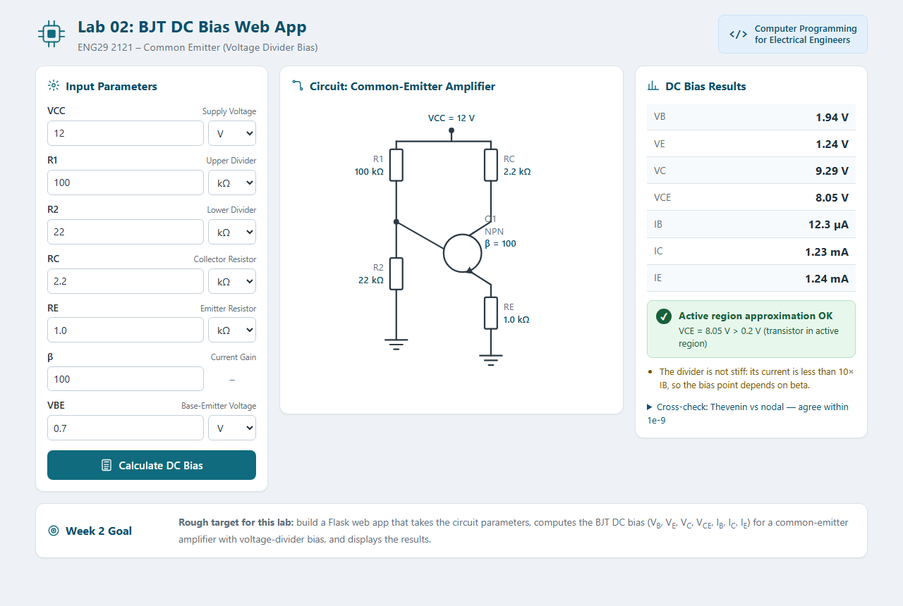
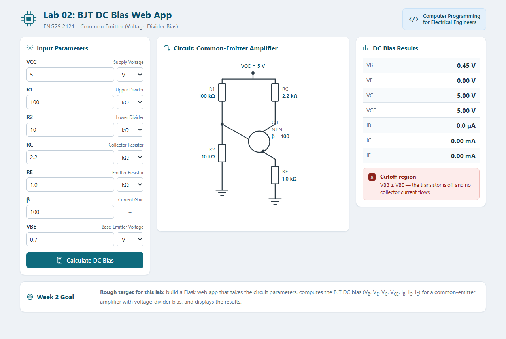
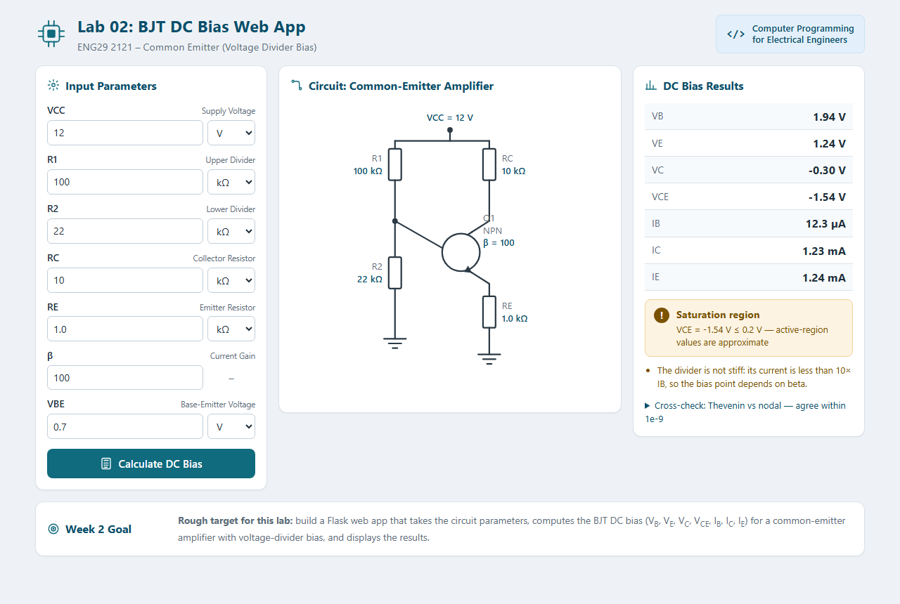
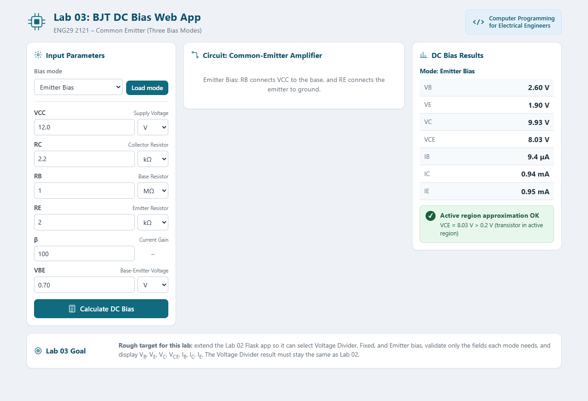
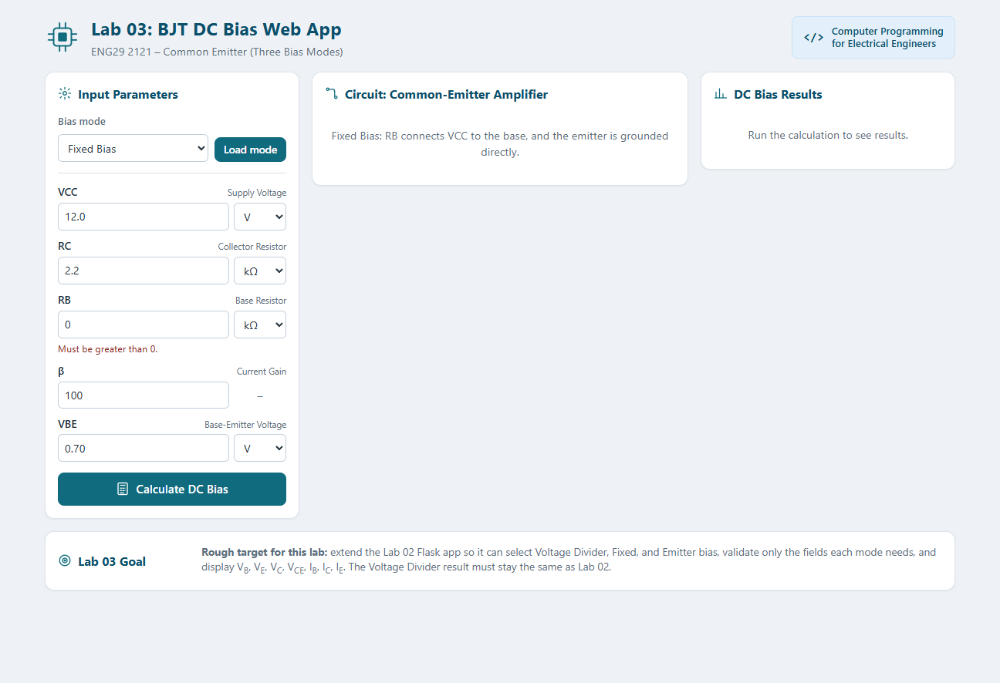

# gitlab

ใช้สำหรับเรียนแลปคอมโปรไฟฟ้า

## DC Circuit Calculator

คำอธิบายและวัตถุประสงค์: โปรแกรมหรือเครื่องมือคำนวณค่าทางไฟฟ้าในวงจรตัวต้านทานแบบอนุกรม ขนาน และผสม มีเป้าหมายเพื่อช่วยคำนวณหาค่ากระแส แรงดัน และกำลังไฟฟ้าได้อย่างแม่นยำ พร้อมอำนวยความสะดวกในการตรวจคำตอบทางทฤษฎี

## BJT Common-Emitter DC Bias (ENG29 2121)

เว็บแอป Flask สำหรับคำนวณจุดทำงาน DC ของวงจรไบอัส Common-Emitter
กรอกค่าองค์ประกอบวงจรแล้วได้ `VB, VE, VC, VCE, IB, IC, IE` พร้อมหน่วย
(IB เป็น µA, IC/IE เป็น mA)

หน้าจอเป็น HTML ล้วน (server-rendered ไม่มี JavaScript) — ช่องกรอกมีตัวเลือกหน่วย
(V/mV และ Ω/kΩ/MΩ) และทุกโหมดมี schematic วงจรของตัวเองเป็น inline SVG
พร้อมค่าที่กรอก

### Lab 02 — Voltage Divider Bias

ผลลัพธ์ของโหมด voltage divider คำนวณสองวิธีอิสระต่อกัน — Thevenin equivalent
และ nodal analysis — แล้วแสดงเทียบกันพร้อมผลต่าง และเตือนเมื่อวงจรอยู่ในโหมด
cutoff หรือ saturation รวมถึงเตือนเมื่อตัวแบ่งแรงดันไม่แข็ง
(กระแสในตัวแบ่งน้อยกว่า 10 เท่าของ IB)

**โหมดนี้คงผลเดิมจาก Lab 02 ทุกค่า** (ตรวจซ้ำใน A1 ของ Lab 03)

### Lab 03 — Three Bias Modes

เพิ่มการเลือกโหมดไบอัสจากหน้าเว็บ ฟอร์มจะแสดงเฉพาะช่องที่โหมดนั้นใช้จริง

| โหมด | ค่าที่ต้องกรอก | สมการหลัก |
|---|---|---|
| `Voltage Divider Bias` | VCC, R1, R2, RC, RE, β, VBE | `IB = (VTH − VBE) / [RTH + (β+1)RE]` |
| `Fixed Bias` | VCC, RC, RB, β, VBE | `IB = (VCC − VBE) / RB` |
| `Emitter Bias` | VCC, RC, RB, RE, β, VBE | `IB = (VCC − VBE) / [RB + (β+1)RE]` |

จากนั้นทุกโหมดใช้ `IC = βIB`, `IE = (β+1)IB`, `VE = IE·RE` (Fixed: `VE = 0`),
`VB = VE + VBE`, `VC = VCC − IC·RC`, `VCE = VC − VE`

- เปลี่ยนโหมดแล้วโหลดฟอร์มใหม่ผ่าน server (`GET /?mode=fixed`) — ไม่ใช้ JavaScript
- แต่ละโหมดมี schematic ของตัวเอง (divider / fixed / emitter) แสดงค่าที่กรอกอยู่บนรูป
- validation ตรวจเฉพาะช่องของโหมดนั้น และแจ้ง error ใต้ช่องที่ผิด
- โหมดที่ไม่รู้จักจะขึ้น error ไม่ถูกตีความเป็น voltage divider เงียบ ๆ
- ถ้า `IB ≤ 0` หรือ `VCE < 0.2 V` จะเตือนว่าแบบจำลอง Forward Active อาจใช้ไม่ได้
  ค่าที่เห็นมาจากสมการ active region และเป็นเพียงค่าประมาณ

### ตัวอย่างหน้าจอ

**Active region** — VCC 12 V, R1 100 kΩ, R2 22 kΩ, RC 2.2 kΩ, RE 1 kΩ, β 100



**Cutoff region** — VCC 5 V, R2 10 kΩ (VBB ต่ำกว่า VBE)



**Saturation region** — RC 10 kΩ (VCE ติดลบ ค่าที่ได้เป็นเพียงค่าประมาณ)



**Emitter Bias (Lab 03)** — RB 1 MΩ, RE 2 kΩ, RC 2.2 kΩ, β 100



**Validation error (Lab 03)** — Fixed Bias, RB = 0 Ω (ไม่มีตารางผลค้างจากรอบก่อน)



### วิธีรัน

```bash
python -m venv .venv
.venv\Scripts\python -m pip install -r requirements.txt
.venv\Scripts\python app.py
```

แล้วเปิด http://127.0.0.1:5000

### วิธีรันเทสต์

```bash
.venv\Scripts\python -m unittest discover -v
```

มี 49 เทสต์ (electrical, bias, app) — Lab 03 ไม่ได้เพิ่มไฟล์ unittest ใหม่
เพราะใบงานกำหนดให้ตรวจพฤติกรรมใหม่ผ่าน Browser

### การตรวจรับ Lab 03 (A1–A5)

ตารางผลตรวจพร้อมค่าอ้างอิงอิสระและหลักฐานอยู่ที่
[`docs/validation.md`](docs/validation.md) — สรุป:

| กรณี | โหมด | IC (mA) | VCE (V) | สถานะ |
|---|---|---|---|---|
| A1 | Voltage Divider (เหมือน Lab 02) | 1.23 | 8.05 | PASS |
| A2 | Fixed, RB 1 MΩ | 1.13 | 9.51 | PASS |
| A3 | Emitter, RB 1 MΩ, RE 1 kΩ | 1.03 | 8.71 | PASS |
| A4 | Emitter, RE 2 kΩ | 0.94 | 8.03 | PASS |
| A5 | Fixed, RB = 0 → error | — | — | PASS |

ตรวจด้วย **OpenCode Browser** กับเซิร์ฟเวอร์จริงบน `http://127.0.0.1:5000`
(กรอกฟอร์มและกด Calculate ในเบราว์เซอร์จริง ไม่ได้เรียกฟังก์ชัน Python ตรง)
