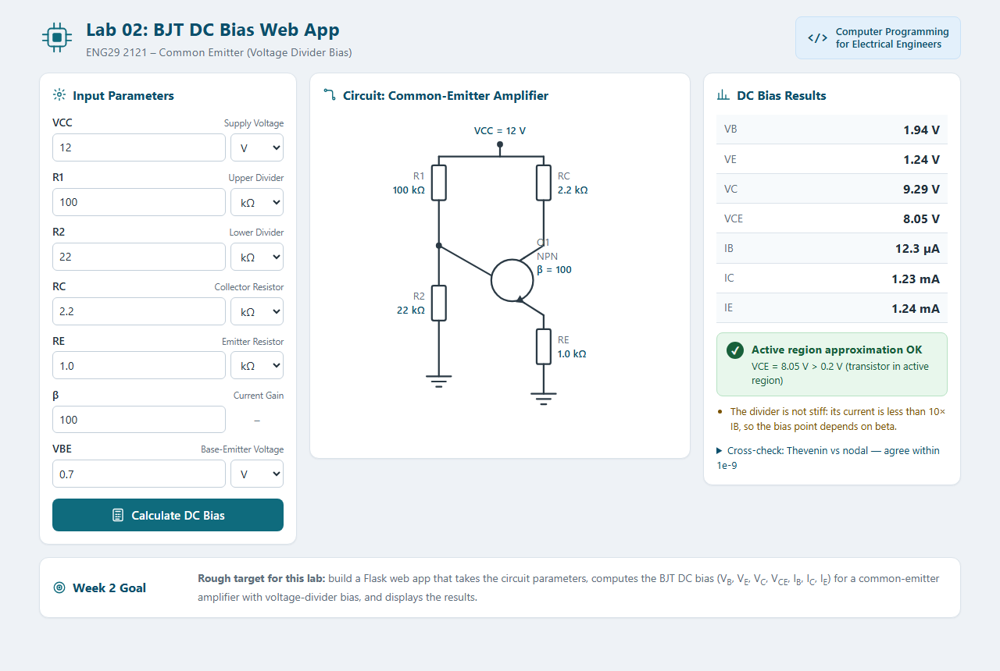
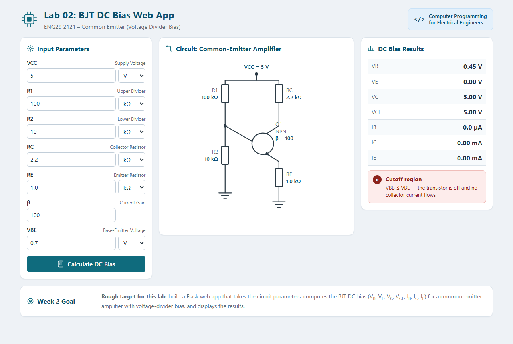
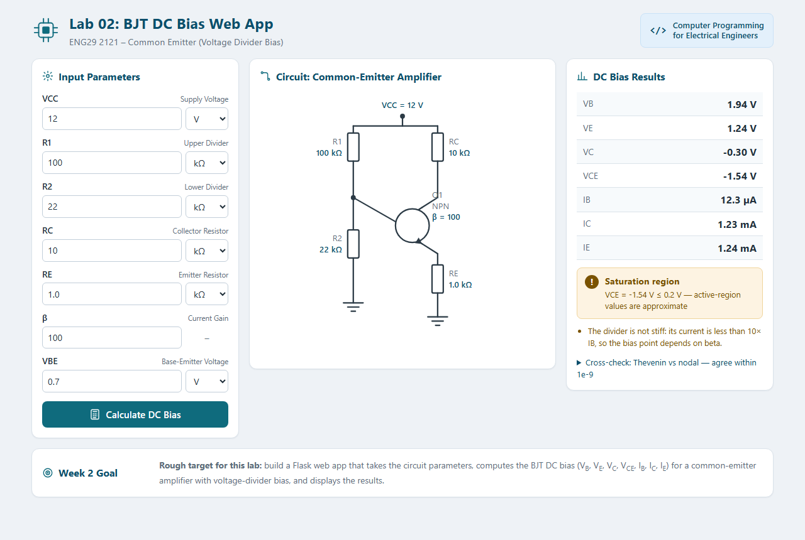

# gitlab

ใช้สำหรับเรียนแลปคอมโปรไฟฟ้า

## DC Circuit Calculator

คำอธิบายและวัตถุประสงค์: โปรแกรมหรือเครื่องมือคำนวณค่าทางไฟฟ้าในวงจรตัวต้านทานแบบอนุกรม ขนาน และผสม มีเป้าหมายเพื่อช่วยคำนวณหาค่ากระแส แรงดัน และกำลังไฟฟ้าได้อย่างแม่นยำ พร้อมอำนวยความสะดวกในการตรวจคำตอบทางทฤษฎี

## BJT Common-Emitter DC Bias (ENG29 2121)

เว็บแอป Flask สำหรับคำนวณจุดทำงาน DC ของวงจรไบอัสแบบ voltage divider
กรอก `VCC, R1, R2, RC, RE, beta, VBE` แล้วได้ `VB, VE, VC, VCE, IB, IC, IE`
พร้อมหน่วย (IB เป็น µA, IC/IE เป็น mA)

ผลลัพธ์คำนวณสองวิธีอิสระต่อกัน — Thevenin equivalent และ nodal analysis —
แล้วแสดงเทียบกันพร้อมผลต่าง และเตือนเมื่อวงจรอยู่ในโหมด cutoff หรือ saturation
รวมถึงเตือนเมื่อตัวแบ่งแรงดันไม่แข็ง (กระแสในตัวแบ่งน้อยกว่า 10 เท่าของ IB)

หน้าจอเป็น HTML ล้วน (server-rendered ไม่มี JavaScript) — ช่องกรอกมีตัวเลือกหน่วย
(V/mV และ Ω/kΩ/MΩ) และมี schematic วงจรเป็น inline SVG

### ตัวอย่างหน้าจอ

**Active region** — VCC 12 V, R1 100 kΩ, R2 22 kΩ, RC 2.2 kΩ, RE 1 kΩ, β 100



**Cutoff region** — VCC 5 V, R2 10 kΩ (VBB ต่ำกว่า VBE)



**Saturation region** — RC 10 kΩ (VCE ติดลบ ค่าที่ได้เป็นเพียงค่าประมาณ)



### วิธีรัน

```bash
python -m venv .venv
.venv\Scripts\python -m pip install -r requirements.txt
.venv\Scripts\python app.py
```

แล้วเปิด http://127.0.0.1:5000

### วิธีรันเทสต์

```bash
.venv\Scripts\python -m unittest discover -v
```
